# eFTI Testbed Architecture

**Version:** 0.2  
**Date:** 2026-05-27  
**Author:** Rainer Türner  
**Status:** Proposal.

---

## How to read

The testbed is a category of system in its own right — a central orchestrator that runs partner-supplied Docker images inside isolated environments, surrounded by counterparties of the roles the partner is not playing. Epic-level AC live in [`../tasks/`](../tasks/) and on the [GitHub Project board](https://github.com/users/turnerrainer/projects/15) — not duplicated here.

---

## 1. What the testbed is and who uses it

A central service that lets a verified eFTI participant test their own Gate, Platform, or AAP implementation against a controlled environment containing the other roles. The participant supplies their implementation as a Docker image; the testbed pulls it, runs it inside an isolated env, surrounds it with counterparty services, and drives scenarios.

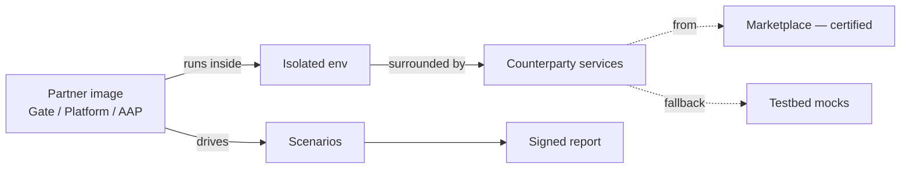

Why it exists: the EU Reference Implementation is a code reference rather than an operational platform, and local setups have no peer Gates and no production-shaped AS4 paths.

### 1.1 Roles

| Side | Role | Concerns |
|---|---|---|
| Operator | Operator | Verifies partners, issues keys, manages tiers, certifies services, removal-for-cause |
| Operator | Operator developer | Builds and runs the testbed itself |
| Participant | Business owner | Decides to participate, accepts terms, sets product scope |
| Participant | Developer | Builds and pushes Docker images, integrates against testbed APIs |
| Participant | QA / certification lead | Drives suites, interprets reports, owns certification decisions |
| External | Report consumer | Anyone shown a signed report who needs to verify it — a downstream certifier, a partner's customer, a government regulator |

Themes are written for business-owner reading; epics carry the AC that developers and QA leads work against.

---

## 2. Core principles

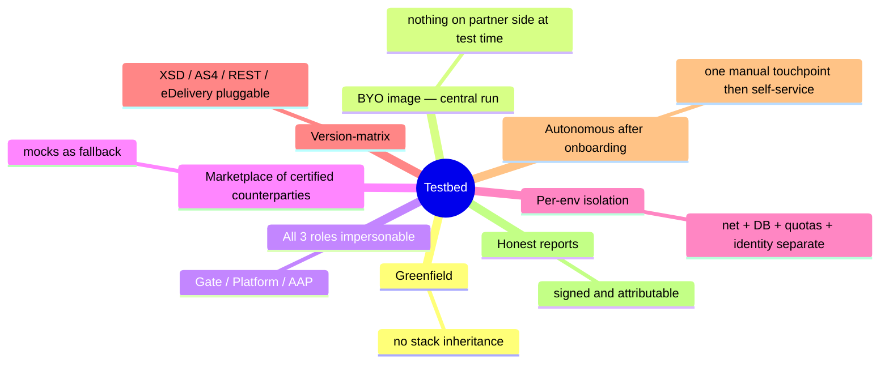

---

## 3. System overview

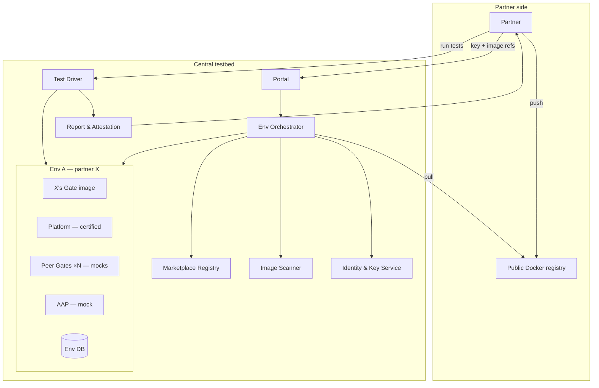

Components:
- **Portal** — auth, env CRUD, image refs, reports
- **Env Orchestrator** — pulls, allocates, wires envs
- **Marketplace Registry** — catalog of certified opted-in counterparties; mocks as fallback
- **Image Scanner** — vuln + manifest checks at pull
- **Identity & Key Service** — partner keys + per-env material
- **Test Driver** — suites + playground
- **Report & Attestation** — per-run reports, signed

---

## 4. Roles, impersonation, env composition

Three eFTI roles: **Gate**, **Platform**, **AAP**. **Each env contains exactly one partner image — total isolation.** The testbed fills the other two roles (and peer Gates where the partner's role is Gate), preferring marketplace counterparties over mocks.

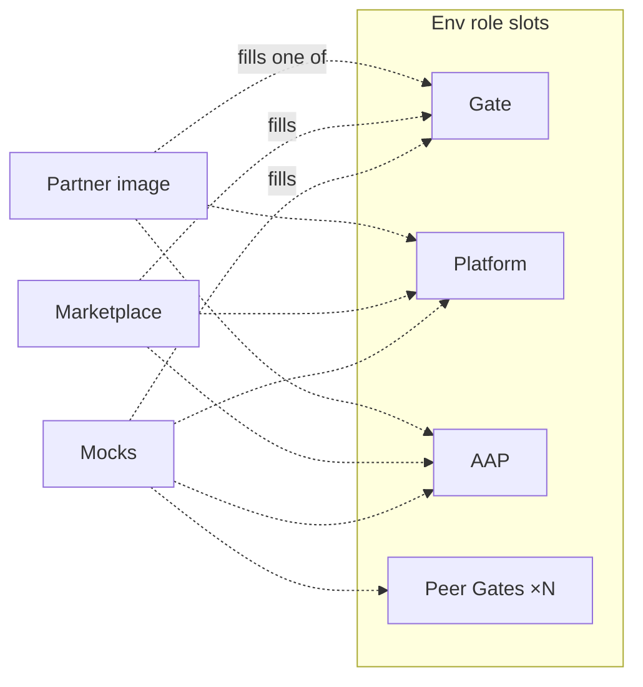

| Partner image | Testbed fills with |
|---|---|
| Gate | Platform + AAP + peer Gates |
| Platform | Gate + AAP |
| AAP | Gate + Platform |

A partner testing more than one of their own roles runs **multiple envs in parallel** — never a single env with multiple of the partner's own images. Peer-Gate impersonation is **N spawned containers** — fidelity needs real cert pairs, real endpoint URLs, real per-peer state, not one process pretending.

---

## 5. Environment lifecycle

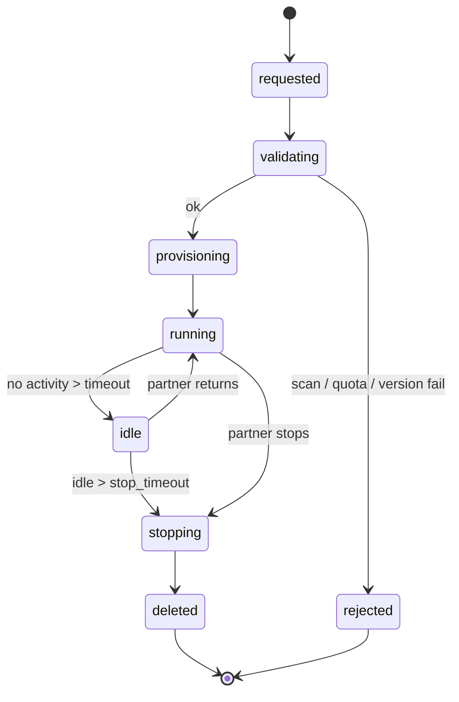

State definitions, durations, override rules: [E5](../tasks/environments/env_crud_and_state.md), [E8](../tasks/environments/idle_stop_reaping.md).

---

## 6. Marketplace, quality gate, counterparty selection

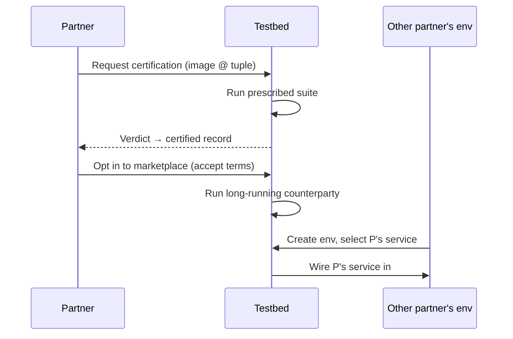

A service becomes a marketplace counterparty after passing the suite for its role and version, opting in, and accepting terms. Other partners pick from compatible listings per role-slot; mocks fall back. Quotas attach to access keys, not envs.

---

## 7. Version matrix

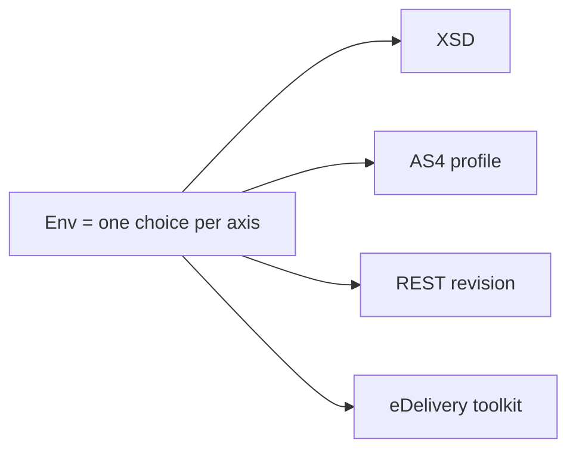

Every protocol-versioned interface is its own axis. An env's tuple is fixed at provisioning. Marketplace listings and suites advertise supported tuples; invalid combos are rejected at validation. The eDANOS XSD v1/v2 transition makes this load-bearing now; the architecture must hold for any future axis.

---

## 8. Image lifecycle

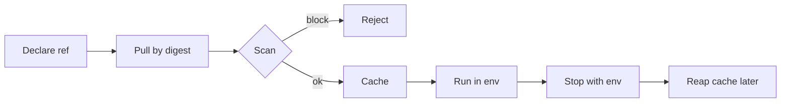

Partner images are arbitrary code. Trust comes from access-key issuance to verified partners; mitigation comes from sandboxing — isolated namespace, egress firewall, resource caps, no privileged containers, no host mounts, ephemeral filesystem outside declared volumes.

---

## 9. Identity

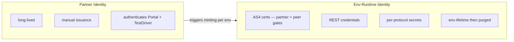

Two layers, never collapsed. Partner keys are long-lived and high-trust; env material is short-lived and disposable. Verification flow: [E1](../tasks/access-and-onboarding/partner_joining_and_verification.md). Issuance mechanics: [E2](../tasks/access-and-onboarding/access_key_issuance.md).

---

## 10. Test execution modes

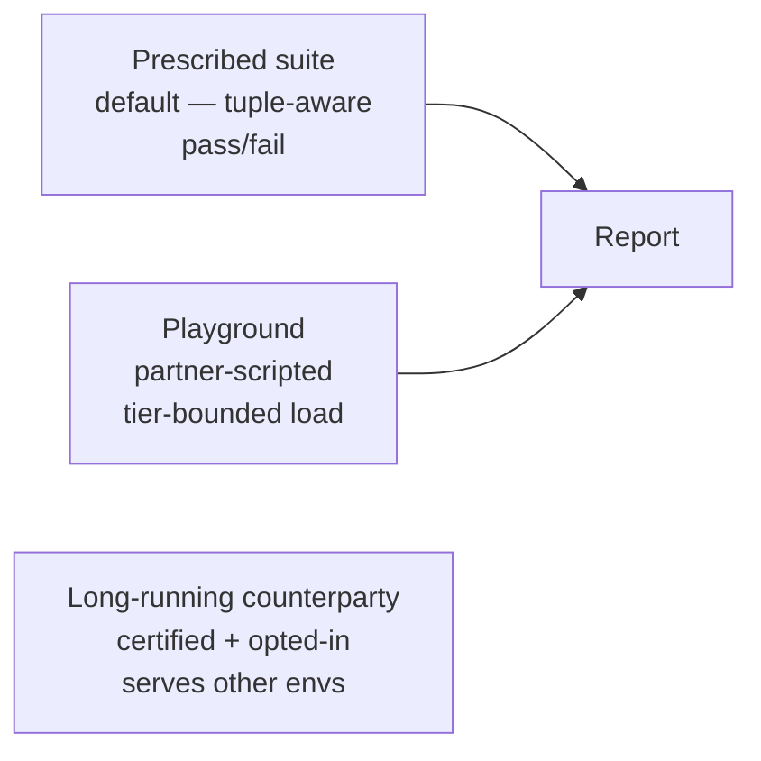

Prescribed and playground share the scripting surface. Long-running counterparty mode is implicit — a certified opted-in service runs in the marketplace, observed but not actively driven.

---

## 11. Reporting & attestation

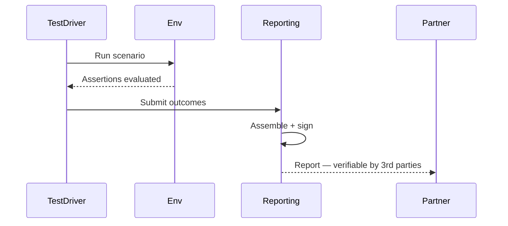

Reports survive env delete. Signature attests provenance — this testbed, this partner, this digest, this tuple, this suite, this date. Whether that constitutes downstream certification attestation is governance, not architecture.

---

## 12. Isolation & security floor

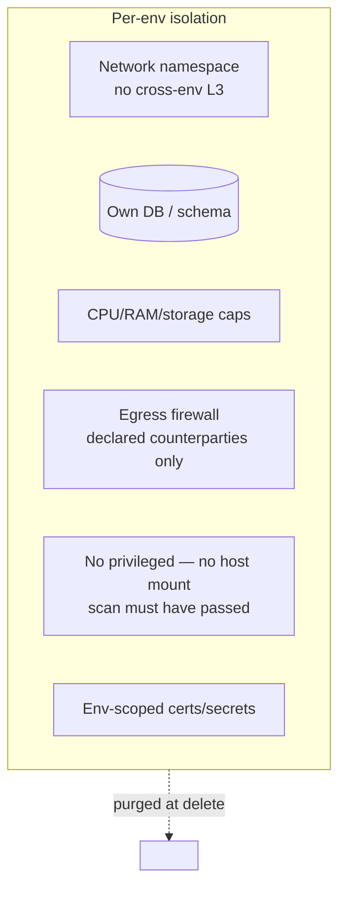

Cross-cutting: portal-side authn; immutable audit log; no real PII in any test data — synthetic only, enforced across all test-data surfaces (mocks E14/E15, playground E20).
