# eFTI Testbed Architecture

**Version:** 0.3  
**Date:** 2026-11-10  
**Author:** Rainer Türner  
**Status:** Proposal.

---

## What changed from v0.2

v0.3 adds two requirements and one new capability. Everything else is carried over from v0.2 unchanged unless listed here.

| Change | Where |
|---|---|
| **Source-code confidentiality** is a first-class requirement: nobody but the partner can read their implementation, including the operator | new §13; §3, §8 amended |
| **Zero-touch deployment**: every step from image reference to running env is automatic, with no human intervention | new §14; §5 amended |
| **Security testing and a shared attack library**: partners check their system against known attack vectors and can contribute newly found ones | new §15; §1, §3, §10, §11 amended |
| Partner images are pulled from a **private** registry with a scoped credential (v0.2 assumed a public registry) | §3, §8 |

---

## How to read

The testbed is a category of system in its own right — a central orchestrator that runs partner-supplied Docker images inside isolated environments, surrounded by counterparties of the roles the partner is not playing. Epic-level AC live in [`../tasks/`](../tasks/) and on the [GitHub Project board](https://github.com/users/turnerrainer/projects/15) — not duplicated here.

---

## 1. What the testbed is and who uses it

A central service that lets a verified eFTI participant test their own Gate, Platform, or AAP implementation against a controlled environment containing the other roles. The testbed answers two questions: **does it work** (functional and interoperability suites) and **is it protected** (security suite against a shared, growing attack library, §15). The participant supplies their implementation as a Docker image; the testbed pulls it, runs it inside an isolated env, surrounds it with counterparty services, and drives scenarios.

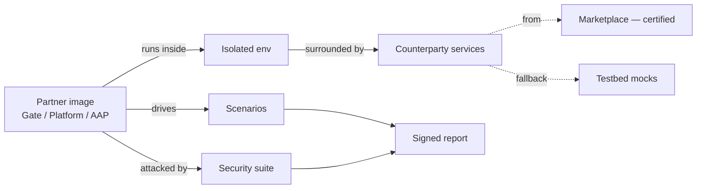

Why it exists: the EU Reference Implementation is a code reference rather than an operational platform, and local setups have no peer Gates and no production-shaped AS4 paths.

### 1.1 Roles

| Side | Role | Concerns |
|---|---|---|
| Operator | Operator | Verifies partners, issues keys, manages tiers, certifies services, removal-for-cause |
| Operator | Operator developer | Builds and runs the testbed itself |
| Participant | Business owner | Decides to participate, accepts terms, sets product scope |
| Participant | Developer | Builds and pushes Docker images, integrates against testbed APIs |
| Participant | QA / certification lead | Drives suites, interprets reports, owns certification decisions |
| External | Report consumer | Anyone shown a signed report who needs to verify it — a downstream certifier, a partner's customer, a government regulator |

Themes are written for business-owner reading; epics carry the AC that developers and QA leads work against.

---

## 2. Core principles

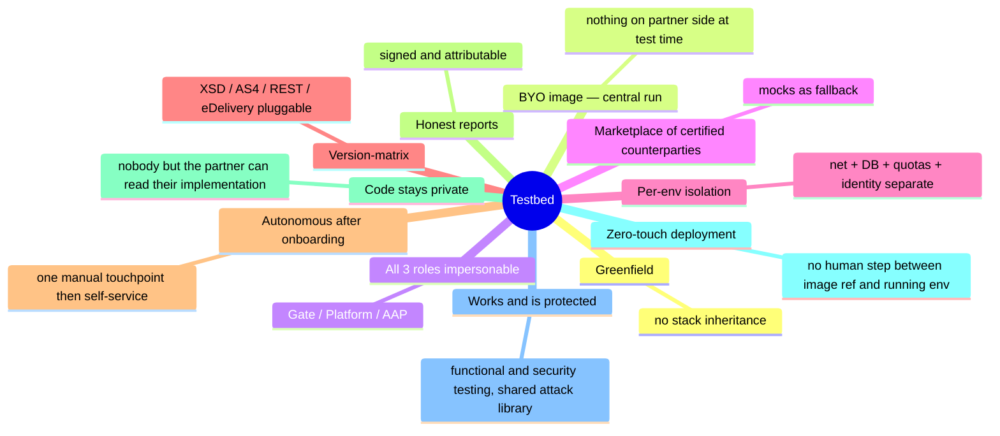

---

## 3. System overview

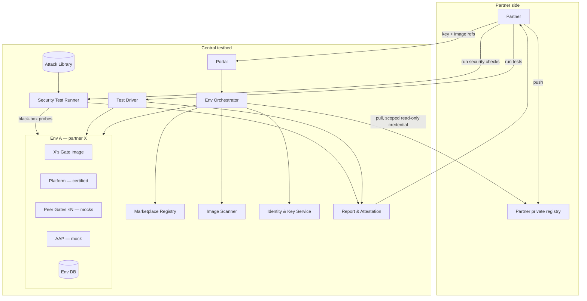

Components:
- **Portal** — auth, env CRUD, image refs, reports
- **Env Orchestrator** — pulls, allocates, wires envs
- **Marketplace Registry** — catalog of certified opted-in counterparties; mocks as fallback
- **Image Scanner** — vuln + manifest checks at pull; runs inside the confidentiality boundary and emits findings only (§13)
- **Identity & Key Service** — partner keys + per-env material
- **Test Driver** — suites + playground
- **Security Test Runner** — runs attack-library probes against the partner's env from outside (black-box)
- **Attack Library** — curated, versioned catalog of known attack vectors (§15)
- **Report & Attestation** — per-run reports, signed

---

## 4. Roles, impersonation, env composition

Three eFTI roles: **Gate**, **Platform**, **AAP**. **Each env contains exactly one partner image — total isolation.** The testbed fills the other two roles (and peer Gates where the partner's role is Gate), preferring marketplace counterparties over mocks.

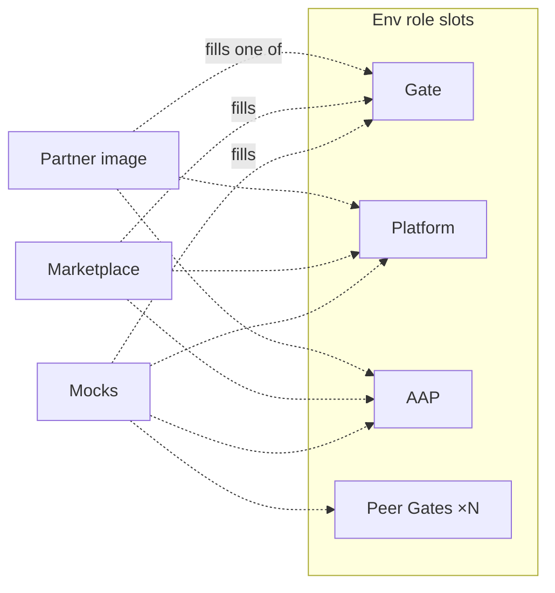

| Partner image | Testbed fills with |
|---|---|
| Gate | Platform + AAP + peer Gates |
| Platform | Gate + AAP |
| AAP | Gate + Platform |

A partner testing more than one of their own roles runs **multiple envs in parallel** — never a single env with multiple of the partner's own images. Peer-Gate impersonation is **N spawned containers** — fidelity needs real cert pairs, real endpoint URLs, real per-peer state, not one process pretending.

---

## 5. Environment lifecycle

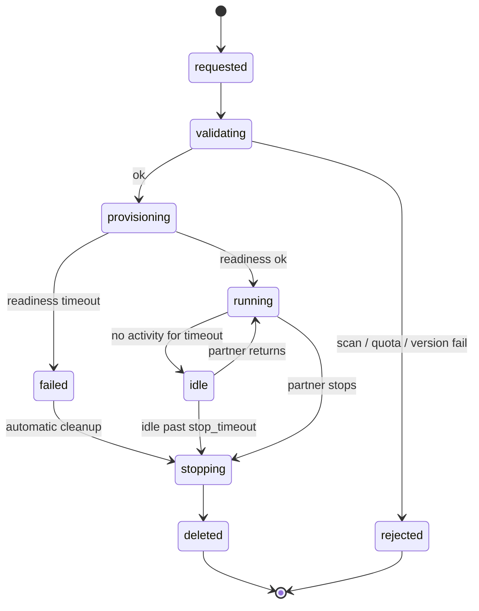

State definitions, durations, override rules: [E5](../tasks/environments/env_crud_and_state.md), [E8](../tasks/environments/idle_stop_reaping.md).

---

## 6. Marketplace, quality gate, counterparty selection

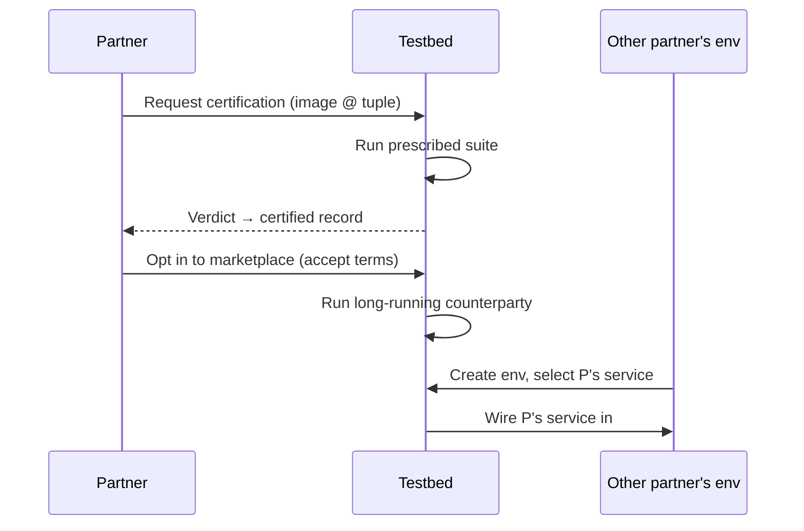

A service becomes a marketplace counterparty after passing the suite for its role and version, opting in, and accepting terms. Other partners pick from compatible listings per role-slot; mocks fall back. Quotas attach to access keys, not envs.

---

## 7. Version matrix

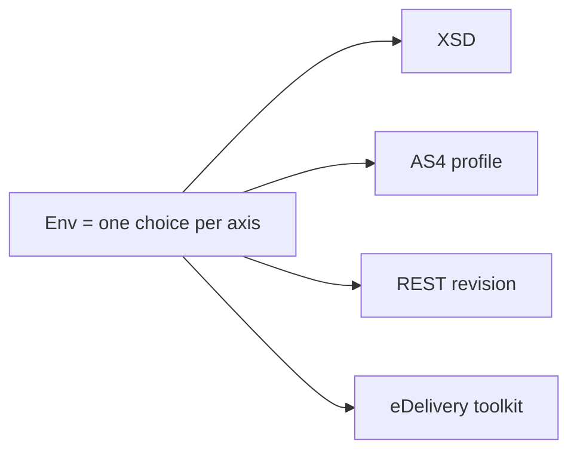

Every protocol-versioned interface is its own axis. An env's tuple is fixed at provisioning. Marketplace listings and suites advertise supported tuples; invalid combos are rejected at validation. The eDANOS XSD v1/v2 transition makes this load-bearing now; the architecture must hold for any future axis.

---

## 8. Image lifecycle

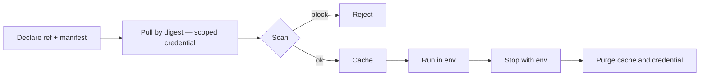

Partner images are arbitrary code and are also the partner's intellectual property. Images are pulled from the partner's **private** registry with a scoped, read-only, time-limited credential (§13). Trust comes from access-key issuance to verified partners; mitigation comes from sandboxing — isolated namespace, egress firewall, resource caps, no privileged containers, no host mounts, ephemeral filesystem outside declared volumes.

---

## 9. Identity

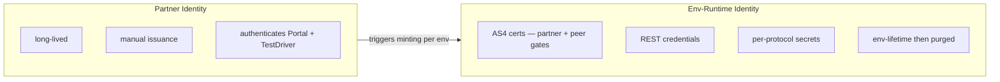

Two layers, never collapsed. Partner keys are long-lived and high-trust; env material is short-lived and disposable. Verification flow: [E1](../tasks/access-and-onboarding/partner_joining_and_verification.md). Issuance mechanics: [E2](../tasks/access-and-onboarding/access_key_issuance.md).

---

## 10. Test execution modes

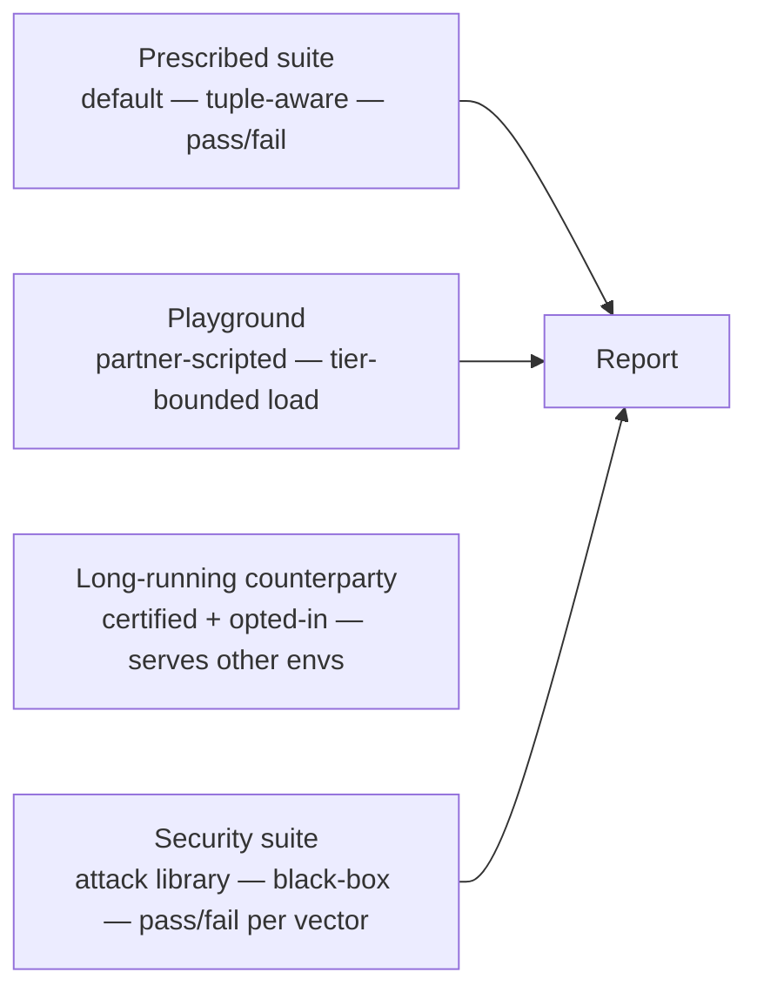

Prescribed and playground share the scripting surface. The security suite is a third mode driven by the attack library (§15). Long-running counterparty mode is implicit — a certified opted-in service runs in the marketplace, observed but not actively driven.

---

## 11. Reporting & attestation

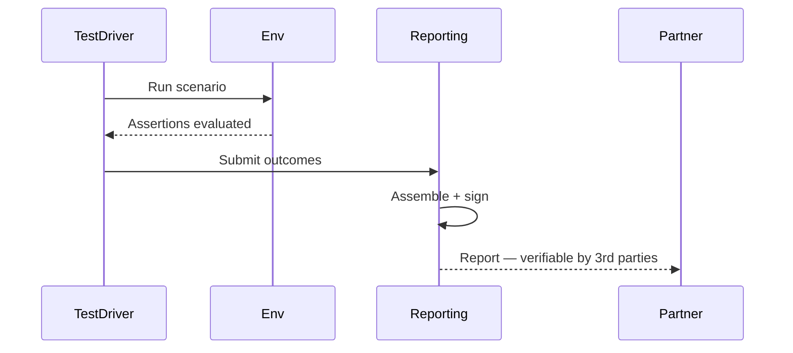

Reports survive env delete. Signature attests provenance — this testbed, this partner, this digest, this tuple, this suite, this attack-library version, this date. A report contains outcomes only: never code, image contents, or raw logs unless the partner chooses to attach them. Security findings are private to the partner; they appear in a report shown to third parties only if the partner includes them. Whether that constitutes downstream certification attestation is governance, not architecture.

---

## 12. Isolation & security floor

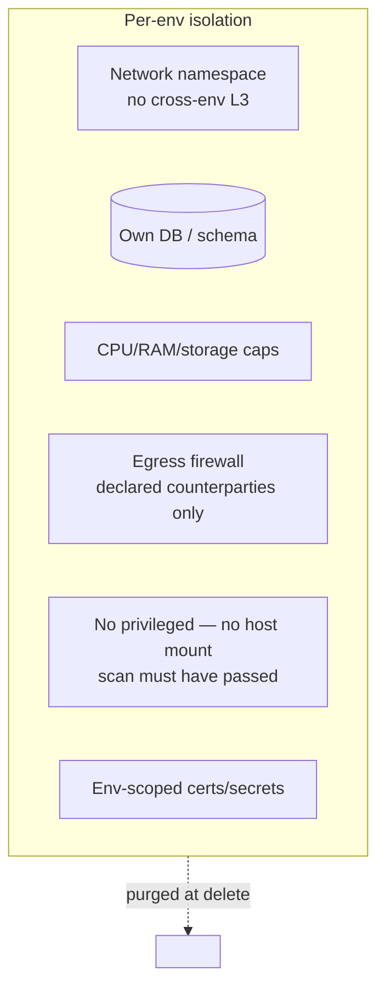

Cross-cutting: no human access to env content (§13, §14); portal-side authn; immutable audit log; no real PII in any test data — synthetic only, enforced across all test-data surfaces (mocks E14/E15, playground E20).

---

## 13. Source-code confidentiality

**Requirement.** A participant's implementation must be unreadable by anyone but the participant: other partners, counterparties in the same env, report consumers, **and the operator and operator developers**. If participants cannot rely on this, they will not use the testbed.

"Source code" in practice means everything inside the image: compiled artifacts, configuration, embedded secrets. The testbed must run the image, so it necessarily handles it. The guarantee is therefore built from layers, each removing a way to get at the content.

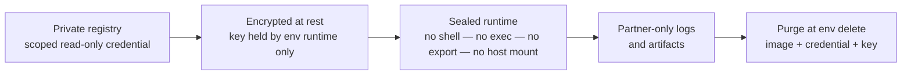

| Who | What they can see |
|---|---|
| Other partners | Protocol traffic only, as with any real counterparty |
| Counterparties in the same env | Protocol traffic only |
| Marketplace consumers of a certified service | An endpoint, never the image: the service runs in its owner's boundary and is wired in by network |
| Operator staff and developers | Control-plane metadata only: env state, image digest, resource usage. No shell, exec, image export, or log content |
| Image Scanner | Reads the image automatically inside the boundary; emits findings (CVE ids, manifest verdicts), never content |
| Security Test Runner | Black-box protocol probes only; never reads the image or the filesystem |
| Report consumers | The signed report: outcomes only |

Rules that follow:
- No operator-facing capability to open a shell, exec, copy files out of, or snapshot a running env or image. The capability does not exist, rather than being forbidden by policy.
- Debug output goes to the **partner only**, through the partner's own authenticated channel.
- Any access to control-plane data about an env is recorded in the immutable audit log, visible to the partner.
- Egress is limited to declared counterparties (§12), so the image cannot send itself elsewhere.

**Stated limits (must be told to partners plainly).** The layers above remove every *supported* path to the content. A determined actor with root on the host could still read memory or disk of an ordinary container runtime. A *technical* guarantee against that actor needs hardware-isolated, attestable execution (confidential computing) with images encrypted to keys released only to an attested runtime. Without it, protection rests on the no-human-access design, audit, and procedure.

**Open:** (1) confidential computing mandatory, optional tier, or later phase; (2) image encryption scheme and key custody; (3) what the operator may state contractually.

---

## 14. Zero-touch deployment

**Requirement.** Every system must be deployable fully automatically. **Every participant provides their implementation as a Docker image, either uploaded or by reference** (below). No human, on either side, touches a deployment between submission and a running env, and **no operator interaction is needed anywhere from submission to report**. This is also what makes §13 enforceable: if a human could intervene, a human could look.

**Intake.** Two automatic paths, both through the Portal API with the partner's access key:
- **By reference**: the partner declares the image reference (by digest) and supplies a scoped, read-only, time-limited pull credential for their private registry; the testbed pulls it.
- **By upload**: the partner pushes the image into a partner-scoped private store on the testbed side; the testbed uses it from there. Subject to the same confidentiality rules (§13).

The partner declares a **deployment manifest** alongside the image ref: exposed ports, readiness endpoint, configuration keys, declared volumes, resource class, version tuple. The testbed supplies everything else (certs, credentials, counterparty endpoints, test data) automatically.

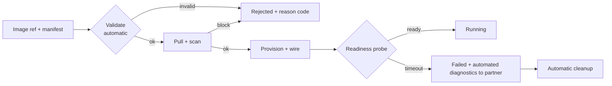

Consequences:
- **No manual approval, no hand-fixing.** Anything not declared in the manifest is rejected at validation with a machine-readable reason. Nobody "helps" a deployment from the inside.
- **Failures are answered by the system.** Diagnostics (state, reason code, the partner's own logs) go to the partner. The operator is not in the loop.
- **Deterministic policy.** Scan verdicts and quota checks are rules, not judgements.
- The only manual touchpoints remain the existing ones: partner verification and key issuance at onboarding (E1, E2) and removal-for-cause. None of them touch env content.

---

## 15. Security testing and the shared attack library

The testbed also lets a partner check that their system is protected, not only that it works. A curated **Attack Library** holds known attack vectors as executable, versioned probes. The **Security suite** runs them against the partner's env and reports a pass/fail per vector with a pointer to the fix. Partners who discover a new vector can submit it, so every other partner can check against it and apply the fix.

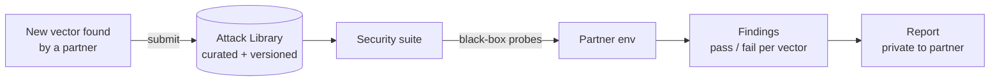

**Sharing a new vector**

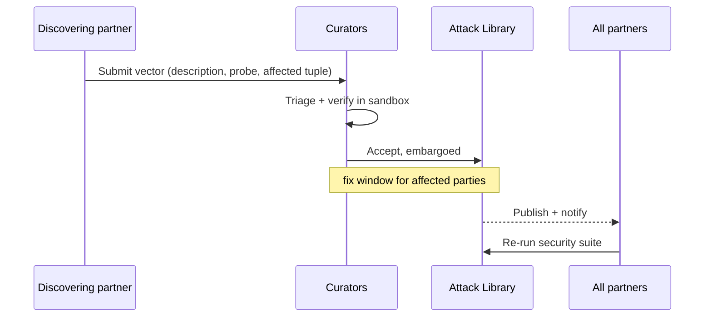

**Vector lifecycle**

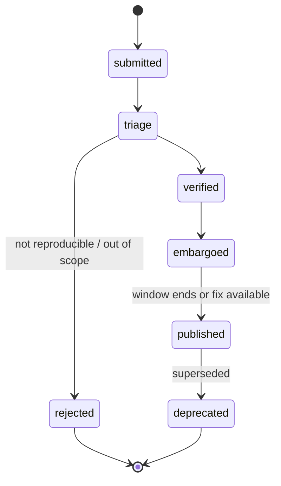

Rules:
- **Black-box only.** Probes go through the same protocol interfaces a real peer would use. They never read the image or the filesystem (§13).
- **Own env only.** A partner's probes run against their own env, never against another partner's service or a marketplace listing.
- **Submissions are untrusted code.** A submitted probe is verified and runs sandboxed like any partner workload (§12); it cannot reach anything but the target env.
- **Submitting reveals nothing about the submitter's source** and does not publish the submitter's own findings; only the vector description and probe are shared.
- **Findings are private** to the partner who ran the suite (§11).
- **Versioned.** Each library release has a version; the report records which version was run. Coverage claim: "checked against library version X", never "secure against all attacks".
- **Identifiers and format.** Every vector carries a standard identifier (CVE where one exists, CWE for the weakness class) plus a **replicable request definition** and an assertion meaning "vulnerable". Collections of replicable requests (e.g. Postman collections run with Newman) are the leading candidate format; the runner is not fixed (see Open).
- The library is **per-axis aware**: a vector declares the role and version tuples (§7) it applies to.

**Open:** (1) disclosure model: embargo length and who is told during the embargo; (2) curation governance: who triages and verifies, and how fast; (3) probe format and runner: Newman, Nuclei, Hurl or similar. Must forbid arbitrary scripting or sandbox it with egress limited to the target env, and must handle signed AS4 messages if eFTI-specific attacks are in scope; (4) coverage scope: generic API/transport attacks, eFTI-specific attacks, or both; (5) whether a submitter may be attributed or anonymous.
