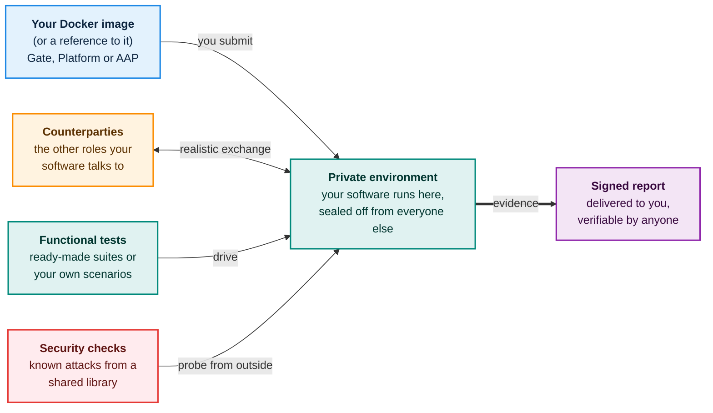
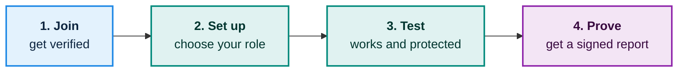

# The testbed at a glance

A verified participant submits their software as a **Docker image**, or a **reference to one**. The testbed runs it in a **private, isolated environment**, surrounds it with **the other roles it needs to talk to**, checks that it **works** and that it is **protected**, and produces a **signed report**. **No person at the testbed is involved at any point between submission and report**, and **nobody can read the participant's code**.

## The big picture

## In four steps

## How your software gets in

> **Docker images only, and fully automatic.** Every participant provides their software in the same way: as a **Docker image**, a standard package that contains everything the software needs to run. You either **upload the image** to the testbed or **give the testbed a reference** to it in your own private store. From that moment, validation, setup, testing and reporting happen **without any human interaction on the testbed's side**. The only person-to-person step is the one-time check at joining.

## Six ideas to remember

<h4>You submit a Docker image</h4>
Either the image itself or a reference to it in your own private store. Nothing has to be installed on your side. The testbed runs it for you.

<h4>Your code stays yours</h4>
Nobody can read it, including the operator. Everything after joining is automatic, so no person at the testbed ever touches your deployment.

<h4>Everything is separate</h4>
Each test environment is sealed off from all others, so partners never see or affect each other.

<h4>Realistic counterparties</h4>
Certified services from other partners where available, built-in stand-ins otherwise.

<h4>Works and is protected</h4>
Functional tests plus checks against a shared library of known attacks that grows when anyone finds a new one.

<h4>Honest, signed reports</h4>
A report says what was tested, when, and with which result, and anyone can check it.

## The three roles

The testbed handles three kinds of eFTI software. A partner tests one of them and the testbed provides the rest.

| If you bring a… | The testbed provides… |
|---|---|
| **Gate** | A Platform, an AAP, and other Gates to exchange data with |
| **Platform** | A Gate and an AAP |
| **AAP** (Authority Access Point) | A Gate and a Platform |

Next: [Who is who](who-is-who.md) explains the people and roles around the testbed.
