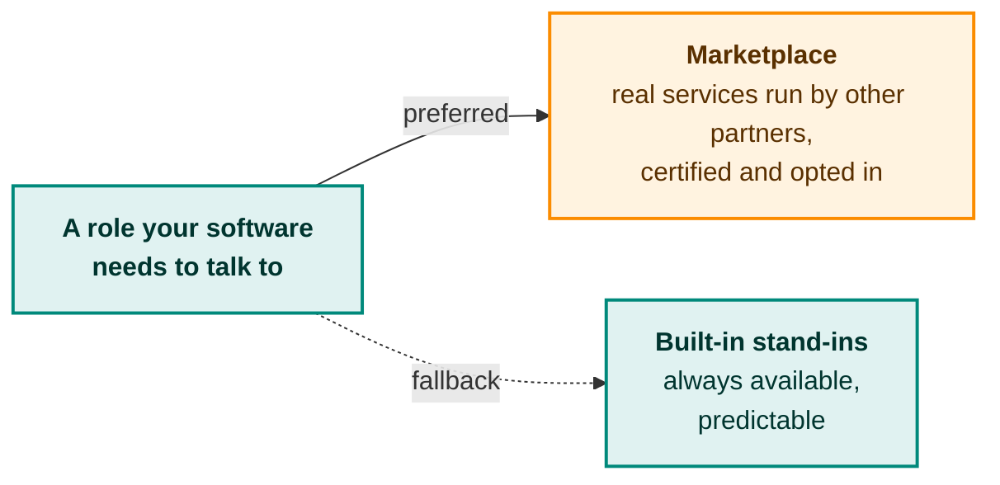

# Your counterparties

Your software talks to other roles. The testbed provides them, from two sources.

## Two sources, one rule



| | Built-in stand-ins | Marketplace services |
|---|---|---|
| **What they are** | Testbed-made Platform, AAP and any number of peer Gates | Real implementations run by other certified partners |
| **Availability** | Always | Depends on the partner |
| **Behaviour** | Deterministic and version-aware | Realistic, as real systems are |
| **Best for** | Repeatable, scripted tests | Realism and surprises |

**Realistic peers.** When your software is a Gate, it needs to talk to several other Gates. The testbed starts **separate, individually identified** stand-ins for each, so that certificates, addresses and state are genuinely distinct. One program pretending to be many would not catch the same problems.

## How a service becomes certified and listed

A partner's service can be listed in the marketplace for others to test against. It must first pass the official test suite for its role and protocol version, then the partner opts in and accepts terms. If the suite is not passed, the owner receives the findings and can fix the problems and try again.

```mermaid
swimlane-beta TB
  subgraph owner [Service owner]
    req([1. Request certification])
    optin[Opt in and<br/>accept the terms]
  end
  subgraph tb [Testbed, fully automatic]
    suite[Run the official<br/>test suite]
    certified[Record the service as<br/>certified, if it passes]
    keep[Keep the service<br/>running and listed]
    wire[Connect it to the<br/>other partner's environment]
  end
  subgraph other [Other partner]
    choose[Choose this service<br/>for a role]
    use([Test against it])
  end
  req --> suite --> certified
  certified -->|certified| optin
  optin --> keep
  keep -->|listed in the marketplace| choose
  choose --> wire
  wire --> use

  classDef partnerC fill:#E3F2FD,stroke:#1E88E5,stroke-width:2px,color:#0D253F;
  classDef opC fill:#FFF3E0,stroke:#FB8C00,stroke-width:2px,color:#5A3000;
  classDef testbedC fill:#E0F2F1,stroke:#00897B,stroke-width:2px,color:#00352F;
  class req,optin partnerC;
  class suite,certified,keep,wire testbedC;
  class choose,use opC;
```

**Terms.** A listed service commits to running obligations: uptime, not keeping other partners' test data, the right to opt out, and removal by the operator if it breaks the terms.

> **Privacy of listed services.** Other partners get a way to **reach** your service, never your software. It keeps running inside your own sealed boundary. See [Trust and safety](trust-and-safety.md).

## Versions must match

eFTI standards change, for example the planned move between message-format versions. Each environment is set up for one specific **combination of versions** (message format, delivery profile, interface revision and so on). Test suites and marketplace listings say which combinations they support, and the testbed only pairs things that fit. Impossible combinations are refused up front, with a clear reason.

This design holds for versions that do not exist yet. A new dimension can be added without reworking the testbed.

Next: [Trust and safety](trust-and-safety.md).
