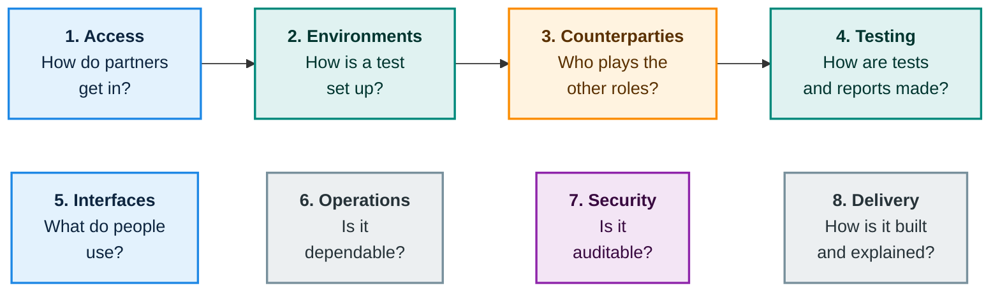

# How it is built and delivered

The work is organised into **eight themes**, each answering a question a stakeholder would ask. Together they hold **31 epics**: business-level units of work with acceptance criteria. This chapter shows the shape of the work, not the schedule.

## The eight themes

The top row is what a partner experiences, in order. The bottom row is what makes it usable, reliable and trustworthy.

| # | Theme | Epics | In plain words |
|---|---|---|---|
| 1 | Access and onboarding | 4 | Applying, being verified, getting a key, usage tiers |
| 2 | Environments | 8 | Creating and stopping environments; keeping them isolated; handling software packages and protocol versions |
| 3 | Counterparties | 6 | Built-in stand-ins, the marketplace of certified services, terms for listed services |
| 4 | Testing and reports | 4 | Official test suites, custom scenarios and load, signed reports |
| 5 | User interfaces | 2 | The partner portal and the operator console |
| 6 | Operations and reliability | 3 | Monitoring, notifications, backup and recovery |
| 7 | Security and compliance | 1 | The tamper-evident activity log |
| 8 | Delivery and documentation | 3 | Stable interfaces, a trustworthy build pipeline, partner documentation |

## New in the current design

Two requirements and one capability were added after the theme structure was drawn up. They cut across several themes and are **still to be broken down into epics**:

<h4>Code confidentiality</h4>
Private software store, encrypted storage, sealed runtime with no operator access, wipe on delete. Touches themes 2, 6 and 7.

<h4>Zero-touch deployment</h4>
A short description of each package, fully automatic setup and automatic failure explanations. Touches themes 2 and 8.

<h4>Security testing and shared attack library</h4>
The library, the security checks, the review process and the report additions. Touches themes 3, 4 and 5.

## How quality is built in

- **Stable interfaces.** All the testbed's own interfaces follow one documented convention, are versioned and have a machine-readable description.
- **The testbed holds itself to its own standards.** Its own build produces signed artefacts with a bill of materials, and its isolation and sandbox self-tests must pass before any release.
- **Documentation for partners** is generated from the interface descriptions where possible and kept current with each release.

Next: [What we need](resources.md).
