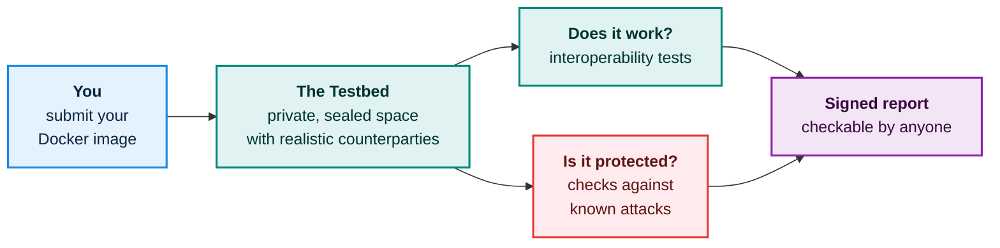

# eFTI Testbed

**A shared, safe place to check that your eFTI software works and is protected, before it goes live. Your code stays yours.**

This book explains, in plain business terms, what the eFTI Testbed is, what it will do for participants, how it is proposed to work, and what is needed to build and run it. It is written for business owners and decision makers. No programming knowledge is needed.

## Three promises

<h4>It works</h4>
Submit your software as a Docker image and test it against realistic counterparties, fully automatically.

<h4>It is protected</h4>
Check your software against a shared, growing library of known attacks, and help others by adding new ones.

<h4>Your code stays yours</h4>
Nobody, including the people who run the testbed, can read your software. This is a design requirement, not a courtesy.

## Where to start

<h4>I want the short version</h4>
Read <a href="at-a-glance.html">The testbed at a glance</a>. It is a two-minute read with one picture.

<h4>I want to know why this exists</h4>
Read <a href="why.html">Why the testbed exists</a>.

<h4>I worry about my code</h4>
Read <a href="trust-and-safety.html">Trust and safety</a>.

<h4>I want to know what is needed</h4>
Read <a href="resources.html">What we need</a>.

<h4>I care about security</h4>
Read <a href="security-testing.html">Security testing</a>.

<h4>I am an operator or regulator</h4>
Read <a href="operators-and-regulators.html">For operators and regulators</a>.

## About this book

> **Status: proposal.** The testbed is in the design stage. Everything in this book describes the proposed design, not a running service.

This book is the business-level view of the design. The full technical design lives in the repository's [`architecture/`](https://github.com/kemit-ee/efti-testbed/tree/main/architecture) folder and keeps evolving. The book is revised alongside it. See [Technical documentation](technical-docs.md) for which architecture version this book currently follows and where to find the details.

Source and issues: [github.com/kemit-ee/efti-testbed](https://github.com/kemit-ee/efti-testbed)
