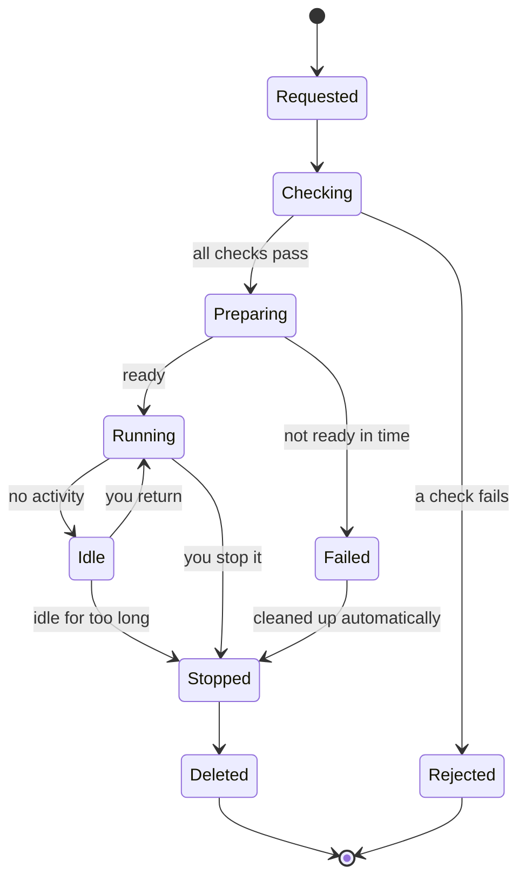

# A partner's journey

From first contact to a signed report. Each column (lane) in the picture is a party, and every arrow that crosses a lane boundary is a handover. Note how little the operator is involved: **joining is the only step where a person at the testbed acts.** From the moment you submit your Docker image, everything is automatic.

## The journey, lane by lane

```mermaid
swimlane-beta TB
  subgraph operator [Operator]
    verify[Verify the organisation]
    key[Issue access key]
  end
  subgraph partner [Partner]
    apply([1. Apply to join])
    submit[2. Submit Docker image<br/>or a reference to it]
    run[3. Start functional<br/>and security tests]
    read([4. Read signed report])
  end
  subgraph testbed [Testbed, fully automatic]
    check[Validate and scan]
    build[Build private<br/>environment]
    ready{Ready?}
    explain[Explain the reason<br/>partner fixes and resubmits]
    test[Run tests<br/>and security checks]
    sign[Sign the report]
  end
  apply --> verify --> key
  key -->|access key| submit
  submit --> check --> build --> ready
  ready -->|yes| run
  ready -->|no| explain
  run --> test --> sign
  sign -->|report| read

  classDef partnerC fill:#E3F2FD,stroke:#1E88E5,stroke-width:2px,color:#0D253F;
  classDef operatorC fill:#FFF3E0,stroke:#FB8C00,stroke-width:2px,color:#5A3000;
  classDef testbedC fill:#E0F2F1,stroke:#00897B,stroke-width:2px,color:#00352F;
  class apply,submit,run,read partnerC;
  class verify,key operatorC;
  class check,build,ready,explain,test,sign testbedC;
```

## What you provide, and what you don't

You provide:
- a verified organisation,
- your software as a **Docker image**, submitted in one of two ways: you **upload the image**, or you **give a reference** to it in your own private store, with a temporary read-only credential,
- a short description of how it starts and what it needs (ports, settings, a "ready" signal).

You do **not** provide: servers, test counterparties, test certificates, test data. The testbed supplies all of these.

> **No person in the loop.** Because setup is fully automatic, nobody at the testbed ever has to log in to your deployment, fix it by hand, or look at it. If something is wrong, you get a clear, automatic explanation. This is also what makes it possible to promise that your code stays private. See [Trust and safety](trust-and-safety.md).

## The life of an environment

An environment goes through a few well-defined states. You can always see which one you are in.



- **Checking** covers the safety scan, the usage limits and the protocol-version combination you asked for. If any fails, you get a reason, and nothing runs.
- **Idle** environments stop themselves to save resources. The proposed defaults are a stop after about 4 hours of inactivity and deletion after about 7 days. The operator can change them, and you get notice before it happens.
- **Reports outlive environments.** Deleting an environment never deletes your reports.

## Fair use: tiers and limits

Every partner has a **tier** that sets how much they can use: how many environments at once, how many image downloads, how heavy a load test may be. Limits belong to the partner's access key, not to a single environment.

## Several roles, several environments

A partner who builds more than one eFTI product runs **one environment per product, in parallel**. They never share an environment (see [Who is who](who-is-who.md)).

Next: [Your counterparties](counterparties.md) explains who plays the other roles.
