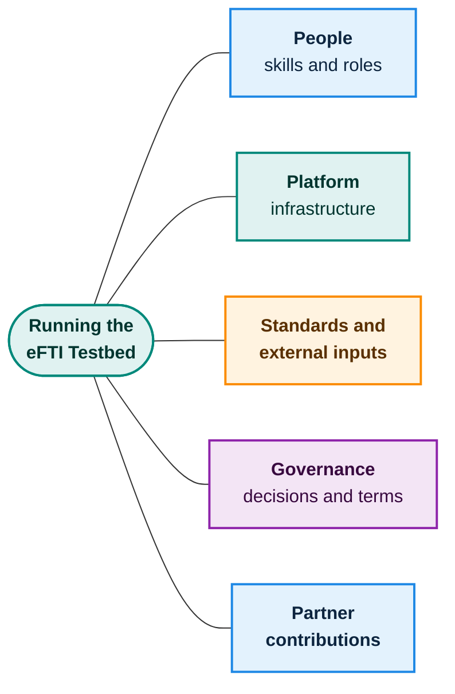

# What we need

This chapter lists **what** is needed to build and run the testbed. It deliberately says nothing about **how much it costs or how long it takes**. Those are separate decisions that depend on the answers here.

## People

| Need | What for |
|---|---|
| **Product ownership** | Keeping the scope, the themes and the book aligned with the architecture as it evolves |
| **Platform and infrastructure engineering** | Isolated environments, the orchestrator, the private-software pull path, monitoring, backup and recovery |
| **Security engineering** | Sealed runtime, encryption and key custody, the scanner, the activity log, the security self-tests |
| **Integration and standards expertise** | The eFTI roles and message formats, the delivery profile, version handling, the built-in stand-ins |
| **Test engineering** | Official test suites, the scripting surface for custom scenarios, reports and signing |
| **Security curation** | Reviewing and verifying new attack submissions and maintaining the attack library |
| **User-experience and front-end** | The partner portal and the operator console |
| **Operations** | Verifying partners, issuing keys, certifying services, handling removal for cause |
| **Technical writing** | Partner onboarding documentation and this book |

## Platform

| Need | What for |
|---|---|
| **Compute that can be isolated per environment** | Running each partner's software in its own sealed space with resource limits |
| **Container hosting and a private pull path** | Fetching partner software from the partner's own private store with a temporary credential |
| **Storage** | Cached software packages, signed reports, backups, activity log |
| **Databases** | Central state; one database per environment |
| **Network controls** | Per-environment networks, outbound restrictions, public-facing protection |
| **Key and secrets management** | Partner keys, per-environment certificates, report-signing keys |
| **Monitoring and notifications** | Health, capacity, alerts to operators and partners |
| **Build and release pipeline** | Signed builds, bills of materials, security self-tests |
| **Confidential-computing hardware** (open decision) | A technical guarantee that even the host cannot read a partner's software. See [Trust and safety](trust-and-safety.md) |

## Standards and external inputs

| Need | What for |
|---|---|
| **eFTI specifications** and the EU reference implementation | What the roles must do and exchange |
| **Message-format and delivery toolkits**, in each supported version | Realistic exchange; building the version combinations |
| **Vulnerability and weakness catalogues** (CVE, CWE) | Identifying and classifying entries in the attack library |
| **A trusted signing arrangement** | So third parties can verify reports |

## Governance

These need decisions by the business, not engineering. They shape what can be built.

| Decision | Why it matters |
|---|---|
| **Terms of use** for participants and for listed services | What participants accept, and what the operator commits to, including the code-privacy promise |
| **What a testbed report is worth** | Whether it counts as certification is for governance and authorities |
| **Who may join** and what verification is required | Sets the level of trust in the environment |
| **How new attacks are handled** | Hold-back period, who curates, naming of submitters |
| **Confidential computing: required, optional or later** | Determines how strong the code-privacy guarantee is |

## Partner contributions

The testbed depends on participants as well:

- **Verified organisations** willing to apply and accept the terms.
- **Software as a Docker image**, uploaded or referenced in the partner's own private store, with a short description of how it starts.
- **Certified services, run as counterparties**, by partners who opt in. This is what makes the marketplace worth using.
- **New attack discoveries**, shared through the review process.

Next: [For operators and regulators](operators-and-regulators.md).
