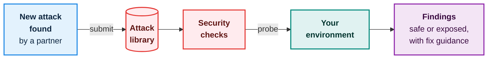
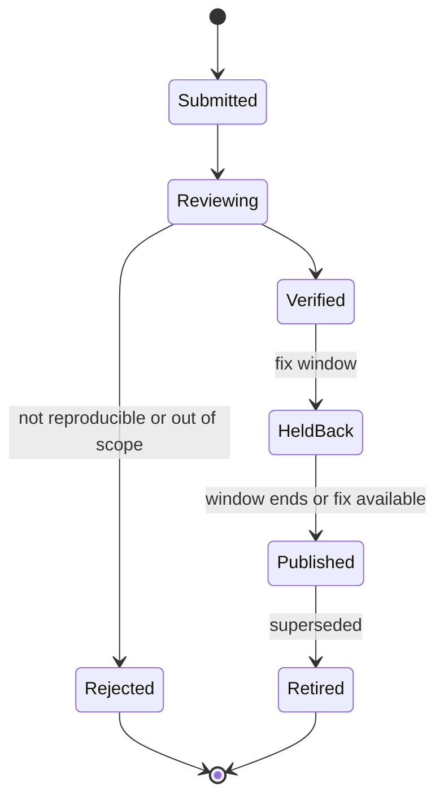

# Security testing

Passing functional tests shows that your software **works**. It does not show that it is **protected**. The testbed does both, and the second part gets better over time, because participants share what they learn.

## How it works

The testbed keeps a **shared attack library**: a curated, versioned collection of known attack methods. Each entry is a ready-to-run check. You run the library against your own software and see, for each attack, whether you are exposed and how to fix it.



Each entry in the library carries:
- a **standard identifier** (a CVE number where one exists, otherwise the CWE weakness category),
- a **replicable request** that demonstrates the weakness, so that the check is repeatable by anyone,
- which **roles and versions** it applies to,
- **fix guidance**.

## When someone finds a new attack

This is the shared-protection loop. One participant's discovery protects everybody.

```mermaid
swimlane-beta TB
  subgraph finder [Discovering partner]
    found([Finds a new attack])
    submit[Submit it with a<br/>replicable request]
  end
  subgraph cur [Curators]
    repro[Reproduce it safely<br/>in isolation]
    ok{Reproduced?}
    reject[Reject and tell<br/>the submitter]
  end
  subgraph lib [Attack library]
    hold[Add it, held back<br/>for a fix window]
    publish[Publish and notify]
  end
  subgraph all [All other partners]
    rerun[Re-run the<br/>security checks]
    fix[Apply fixes if exposed]
  end
  found --> submit --> repro --> ok
  ok -->|no| reject
  ok -->|yes| hold
  hold -->|window ends or<br/>fix available| publish
  publish --> rerun --> fix

  classDef partnerC fill:#E3F2FD,stroke:#1E88E5,stroke-width:2px,color:#0D253F;
  classDef opC fill:#FFF3E0,stroke:#FB8C00,stroke-width:2px,color:#5A3000;
  classDef testbedC fill:#E0F2F1,stroke:#00897B,stroke-width:2px,color:#00352F;
  classDef secC fill:#FFEBEE,stroke:#E53935,stroke-width:2px,color:#5F1412;
  classDef trustC fill:#F3E5F5,stroke:#8E24AA,stroke-width:2px,color:#38093F;
  class found,submit partnerC;
  class repro,ok,reject secC;
  class hold,publish trustC;
  class rerun,fix testbedC;
```

The life of an attack entry:



## The ground rules

<div class="cards">
<div class="card red">
<h4>From the outside only</h4>
Checks behave like a real attacker with network access. They never look inside your software or its files.
</div>
<div class="card teal">
<h4>Only against yourself</h4>
You run checks against your own environment. Never against another partner's service.
</div>
<div class="card purple">
<h4>Results are private</h4>
Findings are yours. They appear in a report shown to others only if you choose to include them.
</div>
<div class="card orange">
<h4>Submitting is safe</h4>
Sharing an attack reveals nothing about your own software or your own findings.
</div>
<div class="card">
<h4>Submissions are untrusted</h4>
A newly submitted check is reviewed and runs in a sandbox, like any outside code.
</div>
<div class="card red">
<h4>Honest wording</h4>
A clean result means "checked against library version X". It never means "secure against everything".
</div>
</div>

## What the report says

The signed report states which version of the attack library was run, the date, and the outcome for each attack. Someone reading it knows exactly what was and was not checked.

## Open decisions

These are governance questions that the business needs to settle. The technical design adapts to the answers.

| Question | Why it matters |
|---|---|
| How long is a new attack held back, and who is told in the meantime? | Publishing at once can help attackers. Waiting leaves others unprotected. |
| Who are the curators, and how fast must they respond? | They decide what enters the library. |
| Are submitters named, or can they stay anonymous? | Affects willingness to share. |
| Which attacks are in scope: general web and interface attacks, eFTI-specific ones, or both? | Sets the size of the effort. |
| Which request format and tool runs the checks? | Needs to be safe by design and able to handle eFTI's signed messages. |

Next: [How it is built and delivered](delivery.md).
