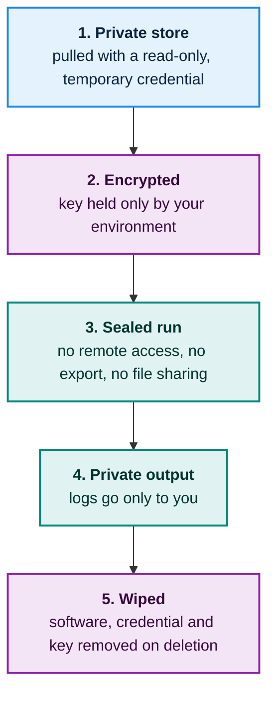
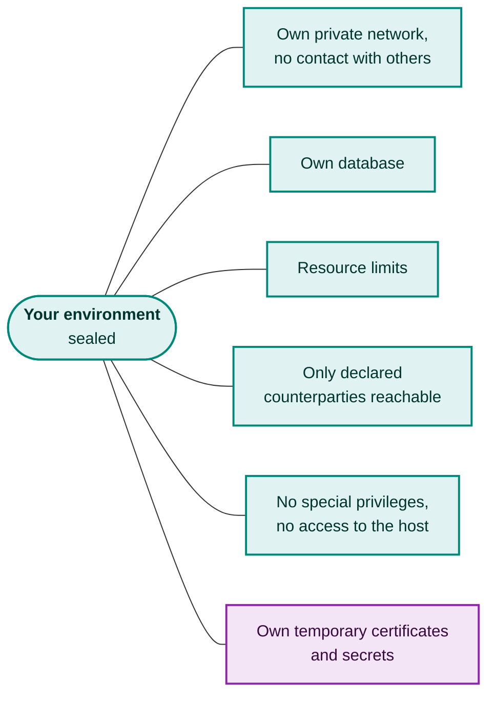
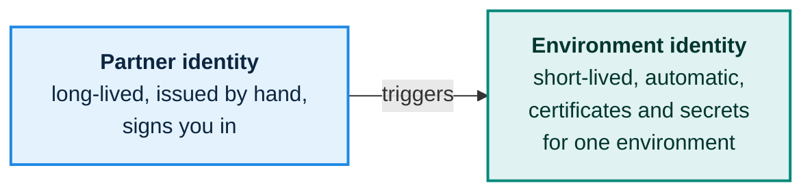

# Trust and safety

A testbed is only useful if participants will put their real software into it. That software is often a company's core intellectual property. So the first promise of the testbed is simple:

> **Your code stays yours.** Nobody can read your software: not other partners, not the counterparties around it, not people who read a report, and **not the people who run the testbed**.

## How the promise is kept

The software must run on the testbed's machines, so it cannot be "invisible". Instead, every supported way of getting at it is removed, one layer at a time.

Two design choices matter most:

1. **The ability simply does not exist.** The testbed has no feature that lets an operator open a session into a running environment, copy files out of it, or take a snapshot. This is stronger than a rule that says "please don't".
2. **No human is needed to deploy.** Everything from "here is my software" to "it is running" is automatic. If a person never has to touch a deployment, a person never has a reason to look into it. Failures are explained to you automatically, not debugged by staff.

## Who can see what

| Who | What they can see |
|---|---|
| Other partners | Only the messages your software sends, as with any real counterparty |
| Counterparties in your environment | Only those messages |
| Partners using your listed service | A way to reach it, never the software |
| Operator staff | Basic facts only: the state of an environment, resource use. No access to the inside |
| Safety scanner | Checks the package automatically and reports findings only |
| Security checks | Probe from the outside, like a real attacker would. They never look inside |
| Anyone reading your report | Outcomes only. No code, no internal data |

## Honest limits

> **What we can and cannot promise.** The layers above remove every supported way of reaching your code. On ordinary server software, someone with full control of the machine could still, in theory, read memory or disk. A **technical** guarantee even against that requires special hardware that keeps your software encrypted while it runs and proves to you that it is genuine (known as confidential computing). Whether that is required for all, an optional higher tier, or a later phase is **an open decision**.
>
> Until then, protection rests on the design above, on activity records that you can read, and on the operator's commitments. We would rather say this plainly now than have it surprise you later.

## Everything is sealed off

Beyond your code, each environment is a sealed box.

## Two kinds of identity, kept apart

Your access key proves who you are and is protected accordingly. The credentials your software uses inside a test are created fresh for each environment and destroyed with it. The two are never mixed, so a leak in a test environment cannot become a leak of your real identity.

## Activity records and test data

- **Audit log.** Every important event is recorded in a tamper-evident log. You can read the entries about your own account and environments.
- **Synthetic data only.** No real personal data is ever used in the testbed. All test data, including data created by the built-in stand-ins and your own scenarios, is artificial.
- **Signed reports.** A report records what was tested and the outcome. It contains no code and no internal data.

Next: [Security testing](security-testing.md) explains how the testbed checks that your software is protected.
