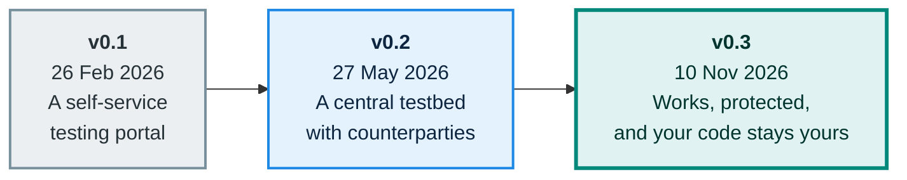

# Version history

The testbed design has gone through three versions so far. Each one is kept in the repository, so you can see how the thinking developed. This book follows the latest.

| Version | Date | Status | In one line |
|---|---|---|---|
| **v0.3** | 2026-11-10 | Proposal. **This book follows it.** | Adds code confidentiality, fully automatic deployment, and security testing with a shared attack library |
| **v0.2** | 2026-05-27 | Superseded | A central testbed that runs participants' Docker images against realistic counterparties |
| **v0.1** | 2026-02-26 | Superseded | A self-service portal for creating isolated test environments |

## v0.3: works, protected, and your code stays yours

*10 November 2026. Proposal.*

- **Source-code confidentiality** became a first-class requirement. Nobody but the participant can read their software, including the people who run the testbed.
- **Zero-touch deployment.** Participants submit a Docker image, or a reference to one. Everything from submission to the signed report is automatic, with no human interaction on the testbed's side.
- **Security testing and a shared attack library.** Participants check their software against known attacks and can contribute newly found ones. Entries carry CVE or CWE identifiers and a replicable request.
- Software is pulled from a **private** store with a temporary credential. v0.2 had assumed a public one.

See [Security testing](security-testing.md) and [Trust and safety](trust-and-safety.md).

## v0.2: a central testbed

*27 May 2026. Superseded by v0.3.*

A redesign around one idea: a participant supplies their software as a Docker image, and the testbed runs it centrally in a sealed environment, surrounded by counterparties.

- Three roles (Gate, Platform, AAP) that the testbed can stand in for, with **one participant's software per environment**.
- A **marketplace** of certified services from other participants, with built-in stand-ins as a fallback.
- A **version matrix**, so that environments, test suites and listings can be matched to protocol versions.
- **Signed reports** that outlive the environment and can be checked by third parties.
- The work was organised into **8 themes and 31 epics**.

## v0.1: the first sketch

*26 February 2026. Superseded by v0.2.*

Written for the eFTI4live project (work package on the architectural design of testbeds). It described a **self-service portal** where users create isolated test environments in seconds, instead of the hours or days that manual deployment took.

- **Two testing tracks:** one for authorities (training on query workflows) and one for economic operators (platform testing and pre-certification).
- Built on an existing national gate implementation.
- Covered deployment scenarios, technology choices, success criteria and risks.

## Where the full versions are

The complete documents are in the repository's [`architecture/`](https://github.com/kemit-ee/efti-testbed/tree/main/architecture) folder: [v0.1](https://github.com/kemit-ee/efti-testbed/blob/main/architecture/v0.1.md), [v0.2](https://github.com/kemit-ee/efti-testbed/blob/main/architecture/v0.2.md) and [v0.3](https://github.com/kemit-ee/efti-testbed/blob/main/architecture/v0.3.md). See also [Technical documentation](technical-docs.md).

## Author

Written and maintained by **Rainer Türner**.
[GitHub](https://github.com/turnerrainer) · [rainer.turner@kemit.ee](mailto:rainer.turner@kemit.ee) · [rainer.turner@gmail.com](mailto:rainer.turner@gmail.com)
