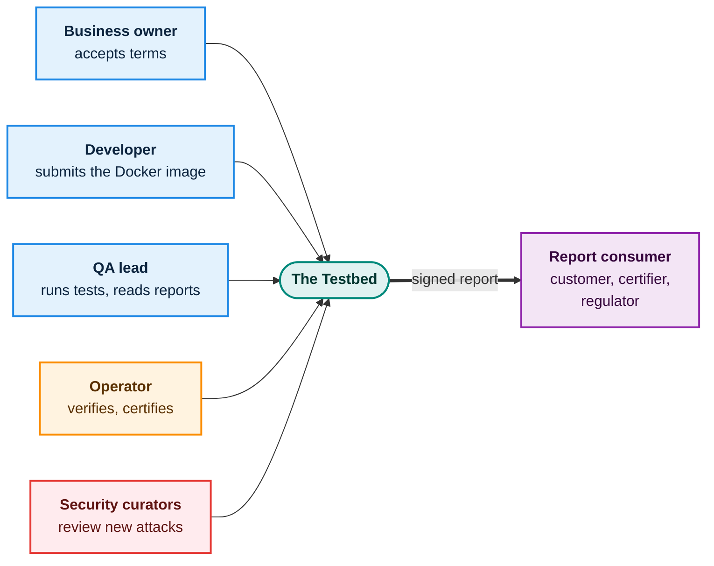
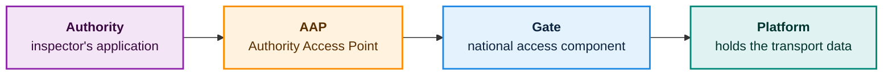

# Who is who

Several kinds of people and software meet around the testbed. This chapter names them, so the rest of the book is easy to follow.

## The people

| Who | What they do | What they decide |
|---|---|---|
| **Business owner** (participant) | Decides to take part and accepts the terms | Which products and roles are in scope |
| **Developer** (participant) | Packages the software as a Docker image and submits it (or a reference to it) to the testbed | How the software is built |
| **QA / certification lead** (participant) | Runs the tests and security checks, reads the reports | Whether the software is ready |
| **Operator** | Verifies partners, issues access keys, manages usage limits, certifies services, removes partners for cause | Who may join and who may stay |
| **Security curators** | Review newly submitted attack vectors before they are shared | What enters the shared attack library |
| **Report consumer** | Checks a signed report: a customer, a downstream certifier, a regulator | What the report is worth to them |

> **Where you fit.** If you are a business owner, you mostly appear at the start (joining, accepting terms) and at the end (reading the outcome). Day-to-day work is done by your developers and QA lead.

## The software roles

eFTI has three kinds of software that exchange transport data. The testbed can stand in for any of them.

A transport inspection touches all three in a chain. An authority asks for data, the request travels through the roles, and the answer comes back the same way.

<h4>AAP</h4>
The Authority Access Point: the entry point that an authority's own applications use to reach the eFTI system.

<h4>Gate</h4>
A national component, provided on the authority side, that lets authorities retrieve transport data from platforms. Gates also exchange requests with other countries' Gates.

<h4>Platform</h4>
The certified system, used by businesses, where transport data is created, held and managed.

> **Simplified, and to be confirmed.** These descriptions are written for orientation and are based on the eFTI Regulation (EU) 2020/1056, its implementing acts and the project's architecture notes. The exact legal definitions should be checked by someone who knows the regulation before this book is published.

## One rule that keeps things simple

**Each test environment holds exactly one partner's software.** The testbed supplies everything else around it. A partner who wants to test two of their own products, say a Gate and a Platform, runs **two environments side by side**. They never share one. This keeps every environment sealed and every result unambiguous.

Next: [A partner's journey](partner-journey.md) walks through the experience from joining to the signed report.
