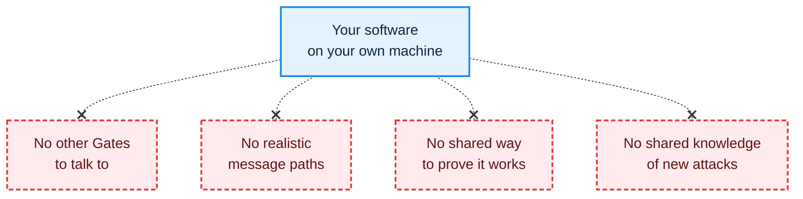
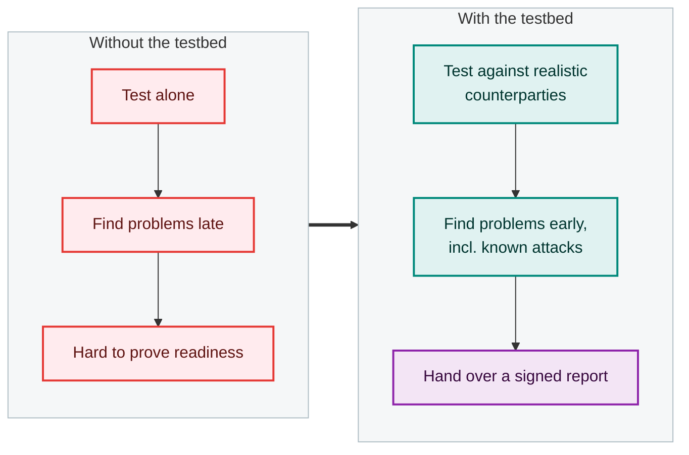

# Why the testbed exists

## The short story

Freight companies, software vendors and authorities across Europe are moving to **eFTI** (electronic Freight Transport Information): transport documents that are exchanged digitally instead of on paper. For that to work, every participant's software must talk correctly to everyone else's, and must be safe to connect to.

Today there is nowhere realistic to check either. The testbed is the proposed answer.

## The problem

- The EU **Reference Implementation** is a code reference, not a running platform you can test against.
- A local setup has **no peer Gates** to exchange data with.
- A local setup has **no production-shaped message paths**, so problems only show up late and at higher cost.
- When one participant discovers a weakness, **others have no common way to learn of it** and check themselves.
- There is **no common, trusted way to show a partner or an authority** that your software was tested.

## The goal

Give every verified participant a **shared, safe place to test**, so that problems are found early, between friendly parties, and the result can be shown to others. And do it in a way that **participants can trust with their most valuable asset: their code**.

## What the business gets

<h4>Lower risk</h4>
Problems, including security weaknesses, are found in a safe environment, not in live operation.

<h4>Less effort</h4>
No need to build and maintain your own test counterparties or your own list of attacks to check.

<h4>Credibility</h4>
A signed report shows customers and authorities what was tested, when, and with what result.

<h4>Shared protection</h4>
When one participant finds a new attack, everyone else can check against it and fix it.

<h4>A healthier ecosystem</h4>
Participants that pass can offer their services as counterparties for others to test against.

## Why it must be trustworthy with your code

A testbed is only useful if participants are willing to put their real software into it. That software is often the company's core intellectual property. If participants cannot be confident that nobody can read it, they will not use the testbed, and it fails at its purpose.

So confidentiality is not an add-on. The design removes the ways to get at a participant's code, including for the people who run the testbed, and everything from deployment onwards is automatic, so no person needs to be involved. [Trust and safety](trust-and-safety.md) explains how, and is honest about the limits.

## What the testbed is not

> **Scope note.** Whether a testbed report counts as an official certification is a decision for governance and the authorities. It is not decided by the technical design. The testbed makes the evidence trustworthy and verifiable. Others decide what it is worth.
>
> Likewise, a clean security result means "checked against the attack library, version X". It does not mean "secure against everything".
